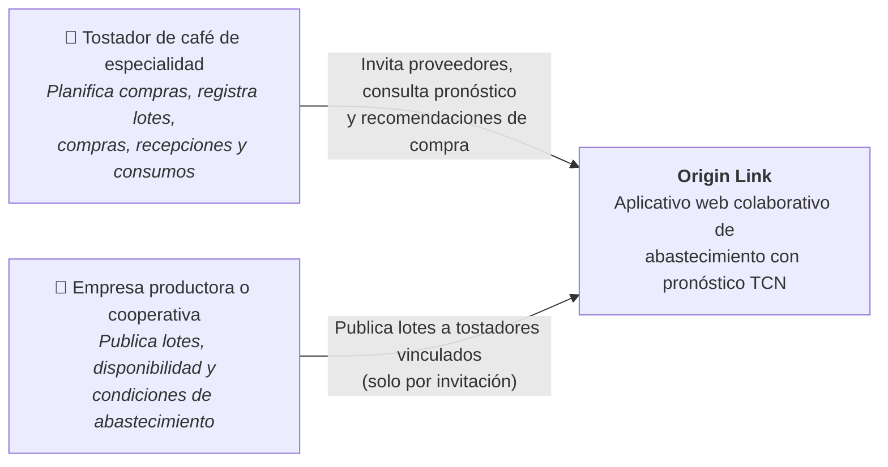
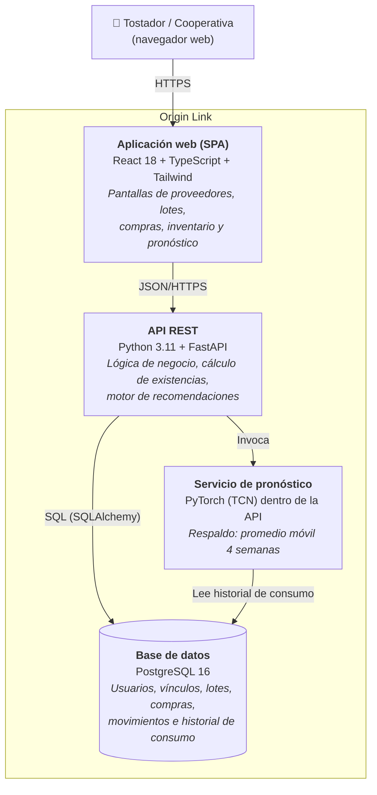
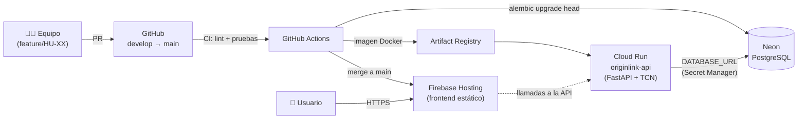

# Arquitectura de Origin Link

Responsable: Luciana Choquehuanca (Arquitecta de Software). Revisión técnica: Christian Inga y Victor Cruz.
Modelo C4 (contexto y contenedores) y vista de despliegue. Las decisiones se registran como ADRs en [`../adr`](../adr).

> Borrador inicial generado con el esqueleto del repo: revisar, completar y aprobar (hito H04).

## 1. Contexto (C4 nivel 1)

Fuera del alcance (exclusiones del Project Charter): pagos, facturación, logística, marketplace público,
datos climáticos externos y recomendación de proveedor.

## 2. Contenedores (C4 nivel 2)

## 3. Despliegue

| Elemento | Servicio | Motivo |
|---|---|---|
| Frontend | Firebase Hosting | CDN, HTTPS y despliegue desde GitHub Actions sin costo |
| Backend + modelo | Cloud Run | Contenedor sin administrar servidores, escala a cero, capa gratuita mensual |
| Base de datos | Neon | PostgreSQL gestionado con plan gratuito permanente |
| Imágenes | Artifact Registry | Repositorio de imágenes Docker en GCP |
| Secretos | Secret Manager + GitHub Secrets | Sin credenciales en el código |

## 4. Módulos de la API (alineados a la EDT)

Detalle completo en el [contrato de la API](../api/contrato-api.md) y el [modelo de datos](modelo-de-datos.md).

| Módulo | Ruta base | EDT |
|---|---|---|
| Identidad y acceso | `/api/v1/auth` | 1.4.2 |
| Proveedores y relaciones | `/api/v1/proveedores`, `/api/v1/invitaciones`, `/api/v1/vinculos` | 1.4.3 |
| Colaborativo (lotes) | `/api/v1/lotes` | 1.4.4 |
| Compras y recepciones | `/api/v1/compras`, `/api/v1/compras/{id}/recepcion` | 1.4.5 |
| Inventario | `/api/v1/movimientos`, `/api/v1/existencias`, `/api/v1/consumo-historico/importar` | 1.4.6 |
| Pronóstico y recomendación | `/api/v1/pronostico`, `/api/v1/recomendaciones`, `/api/v1/alertas` | 1.5.3–1.5.5 |

## 5. Atributos de calidad (pendiente de completar)

| Atributo | Escenario | Medida |
|---|---|---|
| Usabilidad | Un tostador registra un consumo semanal | ≥ 68/100 en el cuestionario (OE4-I1) |
| Precisión | Pronóstico de 4 semanas | MAPE ≤ 25 % y menor que el promedio móvil |
| Seguridad | Una cooperativa sin invitación intenta ver lotes | Acceso denegado (403) |
| Disponibilidad | Falla el modelo TCN | Se responde con el promedio móvil (respaldo) |
