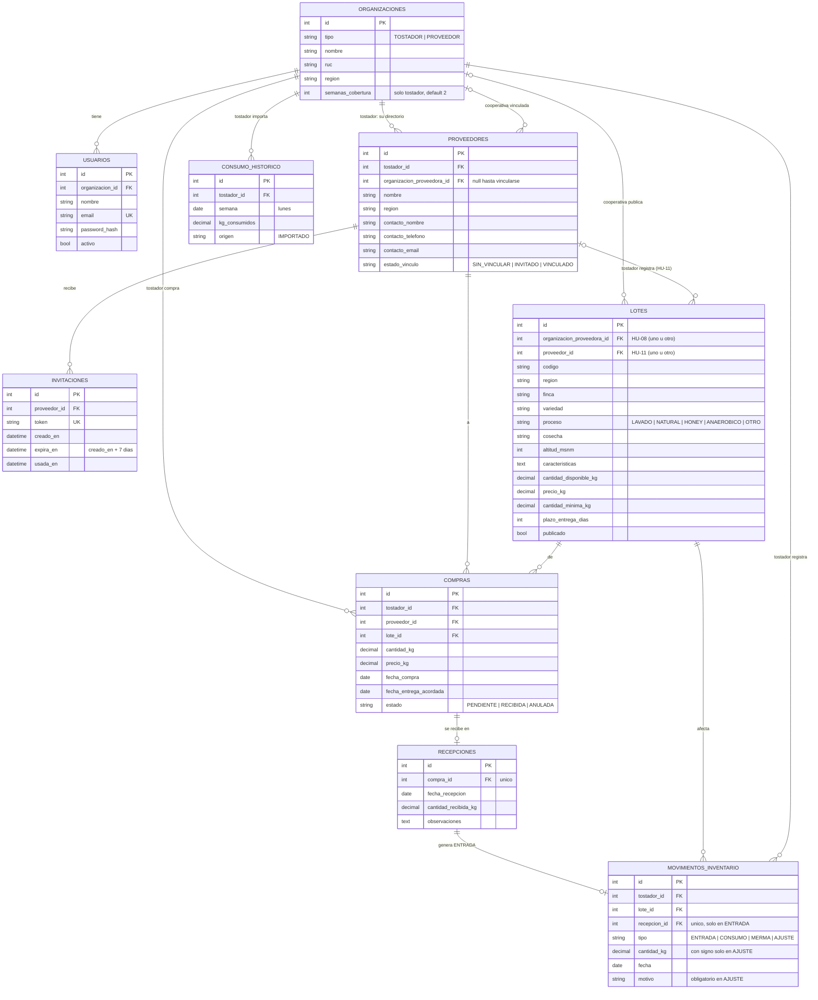

# Modelo de datos del MVP

Responsable: Luciana Choquehuanca (Arquitecta). Implementado en `backend/app/models/` y en la migración
`backend/alembic/versions/0001_modelo_inicial.py` (probada en PostgreSQL 16).

> Propuesta inicial: revisar y aprobar antes de empezar las historias del Sprint A. Cualquier cambio se hace
> con una nueva migración (`alembic revision --autogenerate -m "..."`), nunca editando la 0001 ya aplicada.

## Diagrama entidad-relación



Todas las tablas (salvo invitaciones) tienen además `creado_en` y, cuando cambian, `actualizado_en`.

## Decisiones de diseño

| Decisión | Motivo | Historia |
|---|---|---|
| Una sola tabla `organizaciones` con `tipo` (TOSTADOR / PROVEEDOR) | Tostadores y cooperativas comparten registro, login y usuarios | HU-01, HU-03 |
| `proveedores` es el **directorio de cada tostador**, no una tabla global | Un tostador registra proveedores aunque no tengan cuenta; la misma cooperativa puede estar en el directorio de varios tostadores sin ver los datos de los otros | HU-05, HU-07 |
| El vínculo vive en `proveedores.estado_vinculo` + `organizacion_proveedora_id` | Evita una tabla extra; la invitación aceptada completa ambos campos | HU-03, HU-06 |
| `lotes` pertenece a una cooperativa **o** a un proveedor del directorio, **nunca a ambos ni a ninguno** (CHECK `ck_lote_un_solo_origen`) | Cubre lotes publicados (HU-08) y lotes de proveedores sin cuenta (HU-11) sin ambigüedad sobre quién es el dueño del lote | HU-08, HU-11 |
| Las existencias **no se guardan**: se calculan sumando movimientos | Exclusión del charter: "no predecirá la cantidad actual del inventario"; evita inconsistencias | HU-17 |
| La recepción genera **exactamente un** movimiento `ENTRADA`; no se registran entradas a mano (CHECK `ck_entrada_con_recepcion` + UNIQUE `uq_movimiento_recepcion`) | Toda entrada queda trazada a una compra; una recepción no puede sumar existencias dos veces, y ningún otro tipo de movimiento puede ligarse a una recepción | HU-14, HU-17 |
| `AJUSTE` admite signo y exige motivo (CHECK en BD) | Corrige conteos físicos sin perder la trazabilidad | HU-16 |
| `consumo_historico` semanal separado de los movimientos | El historial importado no tiene lote; el pronóstico suma ambos por semana | HU-18, HU-20 |
| `semanas_cobertura` en la organización del tostador | Parámetro de la recomendación de compra; configurable por tostador | HU-21 |
| Enums guardados como texto (`native_enum=False`) | Agregar un valor no requiere alterar tipos en PostgreSQL | — |
| Cantidades `NUMERIC(10,2)` en kg y precios en soles | Sin errores de redondeo de punto flotante | — |

## Reglas de integridad en la base de datos

Probadas en `backend/tests/test_integridad_modelo.py` (CI) y en PostgreSQL 16.

| Regla | Restricción |
|---|---|
| Un lote tiene un solo origen: cooperativa **o** proveedor del directorio | `ck_lote_un_solo_origen` |
| Solo los movimientos `ENTRADA` tienen recepción, y toda `ENTRADA` la tiene | `ck_entrada_con_recepcion` |
| Una recepción genera como máximo un movimiento | `uq_movimiento_recepcion` |
| Una compra tiene como máximo una recepción | `uq_recepcion_compra` |
| `AJUSTE` con signo y motivo; los demás movimientos, positivos | `ck_movimiento_cantidad`, `ck_ajuste_con_motivo` |

## Reglas de cálculo

```
existencias(lote) = Σ ENTRADA − Σ CONSUMO − Σ MERMA + Σ AJUSTE
diferencia_recepcion = cantidad_recibida_kg − compra.cantidad_kg        (negativo = faltante)
consumo_semanal(semana) = consumo_historico.kg + Σ movimientos CONSUMO de esa semana
```
