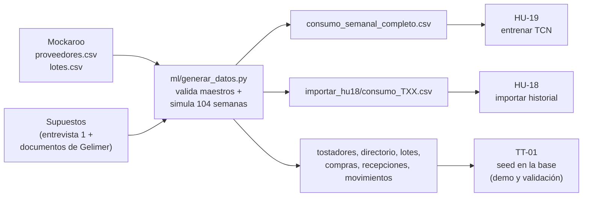

# Datos sintéticos de Origin Link

> **Por qué existen:** los tostadores entrevistados no entregaron su historial de consumo. En el hito
> **H06a (go/no-go de datos históricos)** se decidió *no-go* y se activó el plan de contingencia: simular los
> datos con supuestos documentados y calibrados con la información real disponible. Registrar esta decisión
> en el acta de H06a, en el registro de cambios y en el registro de riesgos (riesgo materializado).

Responsable: Rafael Vivanco (EDT 1.5.1 Datos para el modelo). Uso para el modelo: Victor Cruz (HU-19).

```
datos_sinteticos/
├── mockaroo/      ← ENTRADA: proveedores.csv y lotes.csv descargados de Mockaroo (datos maestros)
└── generados/     ← SALIDA de generar_datos.py (no editar a mano: se regenera)
```

## Flujo



## 1. Datos maestros en Mockaroo (≈ 30 min)

Mockaroo genera bien **datos maestros** (filas independientes entre sí). **No** se usa para el consumo
semanal: cada fila sería independiente de la anterior, sin tendencia ni estacionalidad, y la TCN no tendría
ningún patrón que aprender.

### Esquema `proveedores` — 8 filas

| Field Name | Type | Opciones |
|---|---|---|
| `proveedor_id` | Row Number | — |
| `nombre` | Custom List | Valores (uno por línea): `Coop. Agraria Cafetalera Valle Alto`, `Asociación de Productores Flor de Café`, `Coop. Agraria Selva Central`, `Cafetaleros Unidos de Jaén`, `Asociación Café Sandia`, `Coop. Agraria Pichanaki`, `Productores Orgánicos Villa Rica`, `Coop. Café Rodríguez de Mendoza` · selección **sequential** (para que no se repitan) |
| `region` | Custom List | `Cajamarca - Jaén`, `Amazonas - Rodríguez de Mendoza`, `Junín - Chanchamayo`, `Cusco - La Convención`, `Puno - Sandia`, `San Martín - Moyobamba`, `Pasco - Villa Rica`, `Junín - Pichanaki` · **sequential** |
| `ruc` | Character Sequence | `20#########` |
| `contacto_nombre` | Full Name | — |
| `contacto_telefono` | Character Sequence | `9########` |
| `contacto_email` | Email Address | — |
| `certificacion` | Custom List | `Orgánica`, `Orgánica`, `Fair Trade`, `Orgánica y Fair Trade`, `Ninguna`, `Ninguna` (valores repetidos = más probabilidad; categorías tomadas del *Monitoreo de proveedor* del entrevistado 2) |
| `tiene_cuenta` | Formula | `proveedor_id <= 5` (los 5 primeros tienen cuenta en Origin Link; los otros 3 no) |

### Esquema `lotes` — 30 filas

| Field Name | Type | Opciones |
|---|---|---|
| `lote_id` | Row Number | — |
| `proveedor_id` | Number | min `1`, max `8`, decimals `0` |
| `codigo` | Character Sequence | `LOT-2026-###` |
| `finca` | Custom List | `El Mirador`, `La Esperanza`, `San José`, `Las Orquídeas`, `Santa Rosa`, `Bella Vista` |
| `variedad` | Custom List | `Caturra`, `Caturra`, `Typica`, `Typica`, `Bourbon`, `Catuaí`, `Pache`, `Catimor`, `Geisha` |
| `proceso` | Custom List | `LAVADO` ×6, `NATURAL` ×2, `HONEY`, `ANAEROBICO` (escribir exactamente así, sin tildes) |
| `cosecha` | Custom List | `2026`, `2026`, `2025` |
| `altitud_msnm` | Number | min `1200`, max `2100`, decimals `0` |
| `caracteristicas` | Custom List | `Chocolate y panela`, `Frutos rojos, acidez brillante`, `Cítricos y miel`, `Caramelo y nueces`, `Floral, té negro` |
| `cantidad_disponible_kg` | Number | min `60`, max `600`, decimals `0` |
| `precio_kg` | Number | min `26`, max `42`, decimals `2` (soles por kg; **supuesto a validar** con los tostadores) |
| `cantidad_minima_kg` | Custom List | `5`, `5`, `5`, `10`, `10`, `10`, `15`, `15`, `30` |
| `plazo_entrega_dias` | Custom List | `2`, `4`, `4`, `7`, `7`, `7`, `7`, `10`, `10`, `15` (mediana de 7 días, como en el seguimiento de compras 2021 del entrevistado 2) |

La región del lote no se pide: el generador usa la región de su proveedor.

### Exportar

1. En cada esquema: **# Rows** = 8 o 30 · **Format** = `CSV` · **Line Ending** = `Unix (LF)` · **Include header** = ✓.
2. **SAVE AS…** (`originlink_proveedores`, `originlink_lotes`) para poder regenerarlos.
3. **GENERATE DATA** y guardar los archivos como `ml/datos_sinteticos/mockaroo/proveedores.csv` y
   `ml/datos_sinteticos/mockaroo/lotes.csv`.

## 2. Ejecutar el generador

```bash
cd ml
pip install -r requirements.txt
python generar_datos.py                  # usa los CSV de Mockaroo
python generar_datos.py --maestros-demo  # sin Mockaroo (maestros de ejemplo; útil para empezar ya)
```

El generador **valida** los CSV de Mockaroo y se detiene con un mensaje claro si falta una columna, hay
valores negativos, un `proveedor_id` inexistente o códigos repetidos. Con la misma `--semilla` (42 por
defecto) produce siempre los mismos datos, y **la serie de consumo no cambia al cambiar los maestros**:
Victor puede entrenar la TCN desde ya con la versión de ejemplo.

## 3. Qué simula y con qué supuestos

| Elemento | Supuesto | Fuente |
|---|---|---|
| Tostadores | 4 perfiles ficticios (mínimo 3, como pedía H06a): 6.5, 3.8, 12 y 2.4 kg/semana al inicio | T01 = entrevista 1: 25–30 kg/mes |
| Horizonte | 104 semanas (2 años) hasta el 16/11/2026 | Necesario para que la TCN vea dos temporadas |
| Tendencia | +0.05 % a +0.55 % por semana según el perfil (T02 es un negocio en crecimiento) | Supuesto |
| Estacionalidad | Más consumo en invierno, Fiestas Patrias, agosto (Día del Café Peruano) y diciembre; menos en verano | **Supuesto a validar** con los tostadores |
| Autocorrelación | Una semana alta tiende a seguir a otra alta (AR(1), φ = 0.5) | Supuesto |
| Eventos | 1 a 3 por año (ferias, pedidos corporativos): +20 % a +40 % una semana | Supuesto |
| Política de compra | Repone cuando stock + pedidos no cubren el plazo de entrega + 1.5 semanas; compra para plazo + 2 semanas de cobertura, respetando el mínimo del lote | Entrevista 1: compra cada 2–3 semanas |
| Recepciones | 45 % sin diferencia · 35 % merma leve por humedad (−0.5 % a −3 %) · 12 % peso mayor · 8 % entrega parcial (−8 % a −15 %) | Seguimiento de compras 2021 del entrevistado 2: diferencias e incidencias de humedad |
| Mermas | ≈ 1 de cada 8 semanas, 0.2–0.6 kg | Supuesto |
| Uso de la app | Las últimas 8 semanas se registran como compras, recepciones y movimientos. Antes de eso, solo el historial importado. El primer día se registra un **ajuste de inventario inicial** | Así no se cuenta dos veces el mismo consumo |

## 4. Archivos generados (`generados/`)

| Archivo | Para qué | Quién lo usa |
|---|---|---|
| `consumo_semanal_completo.csv` | Serie completa de 104 semanas (`tostador_id, fecha, kg_consumidos`) | Victor · HU-19 |
| `importar_hu18/consumo_TXX.csv` | Historial por tostador en el formato de importación (`fecha, kg_consumidos`) | Rafael · HU-18 (pruebas y demo) |
| `tostadores.csv` | Organizaciones tostadoras y usuario demo (contraseña `OriginLink2026!`) | TT-01 seed |
| `proveedores.csv`, `lotes.csv` | Maestros validados (de Mockaroo) | TT-01 seed |
| `directorio_proveedores.csv` | Proveedores de cada tostador y su estado de vínculo | TT-01 seed |
| `consumo_historico.csv` | Historial anterior al uso de la app (tabla `consumo_historico`) | TT-01 seed |
| `compras.csv`, `recepciones.csv`, `movimientos.csv` | Las 8 semanas de uso de la app, coherentes con la serie | TT-01 seed |
| `consumo_semanal.png` | Gráfico de las series | Informe y sesiones de validación |
| `resumen.json` | Parámetros, conteos y estadísticas por tostador | Informe |

**Coherencia garantizada por pruebas** (`ml/tests/test_generador.py`): las existencias nunca quedan
negativas, el consumo registrado en la app coincide con la serie, el historial y la app no se superponen,
y la serie no depende de los maestros.

## 5. Resultado preliminar del modelo con estos datos (importante)

Con la semilla 42, la TCN de `train.py` (una serie por tostador, ventana de 12 semanas) **empata con el
promedio móvil de 4 semanas**: a 1 semana, los MAPE quedan entre 7 % y 13 % para ambos, y gana uno u otro
según el tostador. Las dos cumplen OE3-I1 (MAPE ≤ 25 %), pero **OE4-I3 (TCN mejor que el promedio
móvil) no está asegurado**.

No se modifican los datos para que la TCN gane: eso invalidaría la evaluación. Lo que corresponde a HU-19:
1. Entrenar un **modelo global** con los 4 tostadores (series normalizadas): 4 veces más ejemplos.
2. Agregar como entradas **semana del año o mes**, para que la red aprenda la estacionalidad.
3. Evaluar con **origen rodante** y a 1 y 4 semanas, que es el horizonte que usa la recomendación.
4. Si aun así no gana, el sistema elige por tostador el método con menor error de validación
   (ADR-0003). Informar el resultado tal como salga: es un hallazgo válido para el informe.

## 6. Validación de plausibilidad

En las sesiones del 26–28 de noviembre, mostrar `consumo_semanal.png` a los tostadores y preguntar:
*¿Su consumo se parece a esta curva? ¿En qué meses compra más? ¿Cuánto paga por kg? ¿Cada cuánto
recibe con diferencias?* Ajustar los supuestos con sus respuestas y documentarlo.
